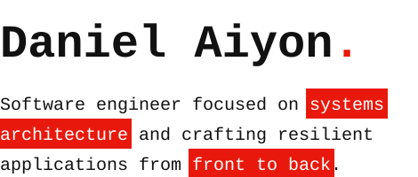
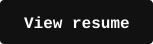

<table>
<tr>
<td valign="top" width="62%">

<picture><source media="(prefers-color-scheme: dark)" srcset="assets/hero-dark.svg" /></picture>

`Semarang, Indonesia` &nbsp; `Politeknik Negeri Semarang`

<a href="https://danielaiyon.net"><picture><source media="(prefers-color-scheme: dark)" srcset="assets/btn-portfolio-dark.svg" /></picture></a> <a href="https://danielaiyon.net/resume.pdf"><picture><source media="(prefers-color-scheme: dark)" srcset="assets/btn-resume-dark.svg" /></picture></a>

</td>
<td valign="middle" align="center" width="38%">

</td>
</tr>
</table>

I build things that work well and look good, whether that is a complex backend or a slick interface. Every project taught me something new about how systems work under the hood, and that is what keeps me going.

<h2><picture><source media="(prefers-color-scheme: dark)" srcset="assets/h-now-dark.svg" /></picture></h2>

|  |  |
|---|---|
| **Building** | React and Laravel projects |
| **Learning** | System design |
| **Looking for** | Open source projects to collaborate on, and a study partner for data structures and algorithms |
| **Ask me about** | Full-stack development |

<h2><picture><source media="(prefers-color-scheme: dark)" srcset="assets/h-projects-dark.svg" /></picture></h2>

Web apps, backend APIs, and experiments, from AI-powered tools to Indonesian folklore visual novels.

<a href="https://danielaiyon.net/projects" target="_blank" rel="noopener noreferrer"><b>Browse all projects</b></a>

<h2><picture><source media="(prefers-color-scheme: dark)" srcset="assets/h-writing-dark.svg" /></picture></h2>

Notes on backend engineering, JavaScript, and Python, in English and Bahasa Indonesia.

<a href="https://danielaiyon.net/blogs" target="_blank" rel="noopener noreferrer"><b>Read all articles</b></a>

<h2><picture><source media="(prefers-color-scheme: dark)" srcset="assets/h-stack-dark.svg" /></picture></h2>

| | |
|---|---|
| **Languages** | `JavaScript` `TypeScript` `Python` `C` `PHP` `SQL` |
| **Frameworks** | `React` `Next.js` `Laravel` `Express` |
| **Tools** | `Git` `Docker` `Linux` `VPS` `Postman` `Prisma` `Supabase` |
| **Database** | `MySQL` `PostgreSQL` `SQLite` |

<h2><picture><source media="(prefers-color-scheme: dark)" srcset="assets/h-contact-dark.svg" /></picture></h2>

`contact@danielaiyon.net`

[GitHub](https://github.com/Aiyon860) &nbsp;/&nbsp; [LinkedIn](https://linkedin.com/in/danielaiyon) &nbsp;/&nbsp; [X](https://twitter.com/DanielAiyon) &nbsp;/&nbsp; [Instagram](https://instagram.com/danielaiyon)

Building systems that matter, one commit at a time.
Writing code from Semarang, Indonesia. Fun fact: I eat a lot, regardless of how skinny I am.
